# Handoff: give the Learning Harness's lesson videos a Branch Education visual language

**For:** a coding agent working in `/Users/itsaibarr/conductor/repos/learning-system` (branch `master`, private repo `itsaibarr/learning-system`).
**Written:** 2026-11-03, after inspecting the repository and studying the reference video frame by frame.
**Decisions already made by the learner (do not re-ask):**
1. Build a **2.5D kit first** (HTML, SVG and CSS 3D inside HyperFrames). Add a locally vendored **Three.js layer later**, and only for scenes that need solid 3D objects.
2. **Labels only, like Branch.** The current rule "one 56 px caption of up to 12 words per beat" is withdrawn. The voice explains; short labels sit next to objects; the folded transcript under each video stays.
3. A prototype kit already exists in `dram-memory/kit/`, and real DRAM lesson scenes are being built with it (`dram-memory/scenes/`). Your job is to turn it into an engine feature and validate it visually against the reference. Do not start from scratch.

You will not need to repeat the research. Everything you need is in this file and the folder `docs/visual-reference/branch-dram/`. That folder holds the full analysis (`reference-analysis.md`), 28 key frames, 6 filmstrips, baseline output and the round-0 probe comparison.

---

## A. Project context (from repository inspection)

### What the harness does
`scripts/learn.py` (about 3,350 lines, stdlib Python) is a learning engine. An agent runs `learn start <topic>` → research brief → `learn plan` → for each unit, one `learn figure` per segment and then `learn block` → `learn ask` / `learn check`. Lessons are written into an Obsidian note. Every segment must embed an engine-checked, **narrated** animation:
- formula-driven maths → **Manim** (`render_manim`, house-styled by `MANIM_HARNESS`);
- everything else → **HyperFrames** HTML scenes.

Router and rules: `AGENTS.md`, `skills/teach-understanding/SKILL.md`, `references/visuals.md`, `references/hyperframes.md`, `references/hyperframes-example.html`. Decisions: `decision-log.md` (rows dated 2026-10-15 cover HyperFrames, captions and the house style). Voice: `docs/voiceover.md`. Learning-science basis: `docs/research/teaching-quality/multimedia.md`.

### The HyperFrames pipeline (`learn.py` lines ~2403–2575)
1. `cmd_figure` sees HTML on stdin → `figure_hyperframes`.
2. `hf_narration` reads `<script type="application/json" id="narration">[...]</script>`; `validate_narration` enforces 4–40 words per line and ≤450 words in total.
3. `tts_lines` speaks each line first (Voicebox server on `127.0.0.1:17493`, Kokoro-82M, voice `af_heart`) and measures the real durations.
4. `hf_prepare`:
   - rejects external URLs, `Math.random`/`Date.now`, timers, endless repeats and `<br>` (`hf_static_problems`);
   - injects `window.LEARN = {start, dur, total}` and `T(i, f)`;
   - replaces `LEARN_TOTAL`;
   - writes `<audio>` tags;
   - copies **only** `index.html`, `gsap.min.js`, `hyperframes.json` and `audio/` into a temp project.
5. `npx hyperframes@0.8.161 check --json` must have no `error` findings (`hf_check_problems`).
6. `hyperframes render --quality draft` (env `LEARN_HF_QUALITY`); duration within 1.5 s of the narration; ≤30 MB.
7. `save_figure` copies the MP4 to the vault (`Attachments/learn/<topic>/<name>.mp4`) and `preview_sheet` writes a 3×2 frame sheet to `~/.local/share/learning-system/previews/`.

Timing model: lead 0.25 s, 0.35 s gap between lines, 2 s tail (`NARR_LEAD/GAP/TAIL`). Scene authors place events with `T(line, fraction)`.

### Current look and its limits
`baseline/current-harness-rag-query-layers.png` is a recent real render:

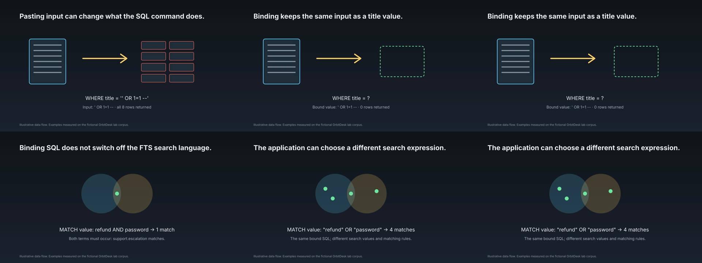

- A sentence caption as a headline in every beat, flat outline icons, wide empty space, no camera, no depth, no labels attached to parts. The rules in `references/hyperframes.md` produce exactly this: a 56 px caption, "at most 4 text items", and a navy sky.
- Only Inter is available. HyperFrames resolves a short alias list (Inter, Roboto, Montserrat, Open Sans, JetBrains Mono, Space Mono, IBM Plex Mono, League Gothic, Archivo Black, EB Garamond, Playfair Display, Source Code Pro, Noto Sans JP). Any other family fails lint with `font_family_without_font_face`.
- Nothing but `index.html` and `gsap.min.js` reaches the render project, so there is no shared library of visual parts. Every scene re-implements its helpers inline. The worked example has an "ENGINE (keep as is)" item registry and beat loop that each scene copies.
- `preview_sheet` takes 6 evenly spaced frames, not frames at the narrated beats. No tool compares output against a reference.
- `hyperframes check` reports overlapping text only as `info`, and the engine ignores info.

### Facts established while prototyping (HyperFrames 0.8.161, on this machine)
- `stroke-dashoffset` tweens via `attr`, `onUpdate` counters writing `textContent`, `x/y/scale` camera tweens on a wrapper, a static CSS `perspective() rotateX()` floor, and SVG built with `createElementNS` all **pass** `check`.
- A full-screen vignette `div` placed *above* text triggers `text_occluded` **errors**. Put it below the content layers.
- An `@font-face` with a **data-URI WOFF2** passes lint and renders. This is how the prototype gets Saira Semi Condensed (OFL, subset to Latin, about 11 KB per weight).
- HyperFrames fetches Google Fonts for alias families on first use and caches them in `~/.cache/hyperframes/fonts/`.
- `npx hyperframes snapshot <dir> --at t1,t2 --no-end -o <out> --describe false` captures exact frames. `--against <video>` saves reference frames at the *same* timestamps, which only helps when the timings match. For our scenes, build pairs with ffmpeg (Section D).
- Warnings you can ignore: `nested_structure_needs_subcomposition` and `escaped_container` on a camera-scaled world.
- The browser renders with the GPU (`ANGLE Metal, Apple M5`). WebGL is available for a later Three.js layer.

### Work in progress you must not clobber
`git status` shows **uncommitted changes in `scripts/learn.py`, `scripts/test_learn.py` and `state/learner.json`** made by the learner, plus untracked folders. Read them and work around them. Never reset or overwrite them. Commit only when the learner asks; if you do, branch first. `state/learner.json` is owned by `learn` commands; never hand-edit it.

---

## B. Visual reference: what to reproduce

Reference: Branch Education, *How does Computer Memory Work?* https://www.youtube.com/watch?v=7J7X7aZvMXQ (35:32, made in Blender). Full breakdown: `visual-reference/branch-dram/reference-analysis.md` (16 techniques, palette, typography, timing, and a 28-frame catalogue with timestamps).

The core of the style:

| Reference | What it demonstrates | Requirement it becomes |
|---|---|---|
| 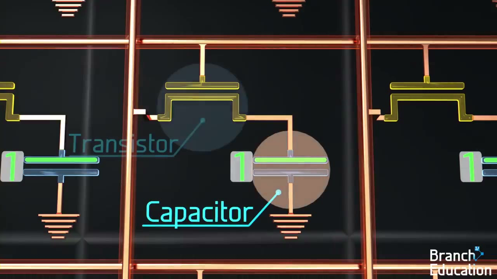 15:04 | Schematic cell on a dark board. Translucent **lens** on each part. **Callouts** (dot → leader → underline → 1-word label) appear as the word is spoken | R5 callouts + lens, R10 sync |
| 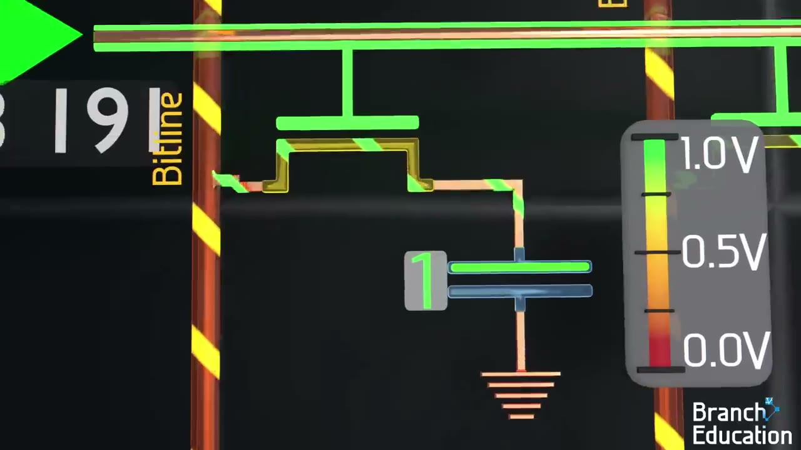 18:08 | **Live instruments**: a voltage gauge and readouts ticking 1.00 → 0.90 V and 0.50 → 0.65 V; green = active wordline; striped bitline = charged | R7 instruments, R6 colour grammar, R8 flows |
| 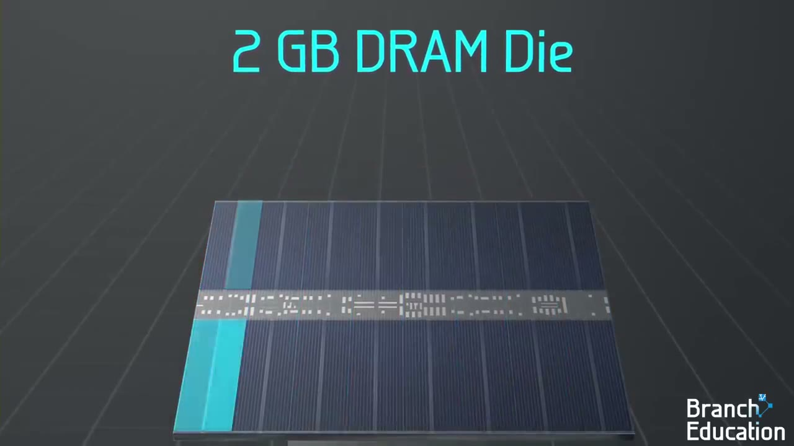 8:32 | A **scale step** on the grid floor (die → banks) with a headline count | R3 worlds, R4 camera journey, R9 headline figures |
| 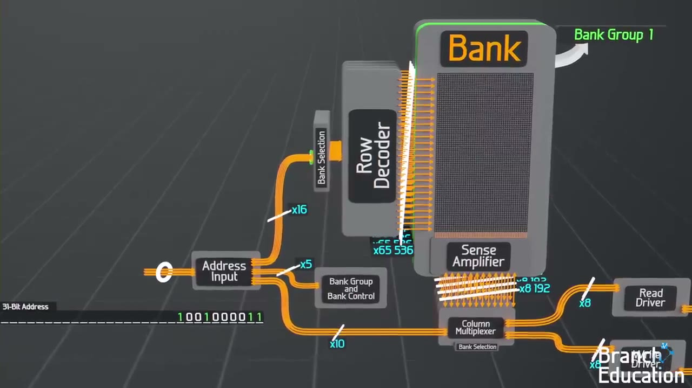 9:20 | Physical → **functional block diagram**: grey plates, orange buses with width labels | R9 blocks and buses |
| 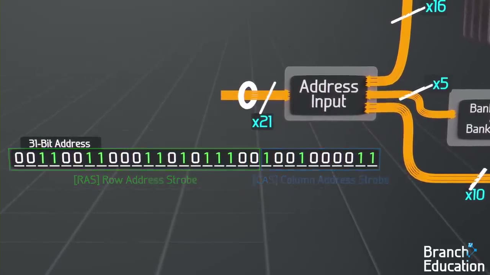 9:48 | **Binary as structure**: a 31-bit address bracketed into coloured fields | R9 bit strings |
| 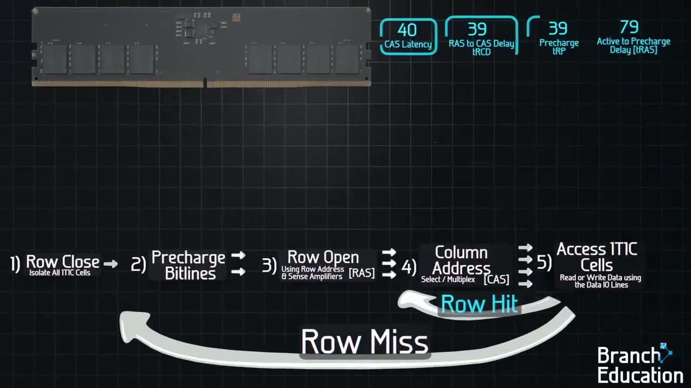 26:24 | **Process chain with a skip arc** (row miss vs row hit), then timing bars | R9 process chains, bars |
| 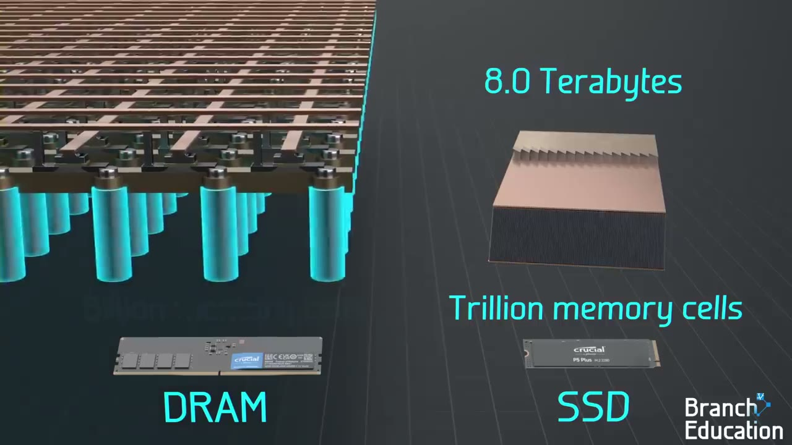 1:04 | **Comparison** on one baseline with big-number labels | R9 comparisons |
| 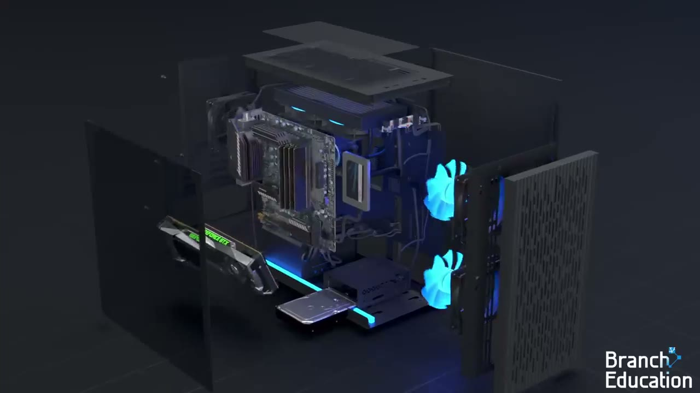 0:04 | **Exploded view** of a lit 3D object | R12 (Three.js phase; 2.5D approximation first) |

Transitions to study (`visual-reference/branch-dram/strips/`, 1 frame/s):
- `0905s-cell-to-array-pullback.jpg`: labels appear one per spoken word.
- `0600s-array-to-die-pullback.jpg`: continuous scale journey.
- `1090s-sense-amp-read.jpg`: numbers and flows change together.
- `1576s-row-hit-skip.jpg`: the chain being drawn.

**Measured style tokens:**

| Token | Value |
|---|---|
| Floor background (wide shots) | Charcoal, #1e2225 at the edges to #46494b in the centre, perspective grid |
| Board background (close-ups) | #101417 / #111518 with a faint grid |
| Cyan | #38d6e6 (labels) |
| Green | #4cf04a (on / 1 / active / hit) |
| Red | #ff5a4d (off / 0 / miss / interference) |
| Orange | #f29a1a (signal buses, warnings) |
| Yellow | #f2e93a (power, charge, hazard stripes) |
| Copper | #c8825a (physical wires) |
| Font | A narrow squarish technical sans. Use Saira Semi Condensed (OFL). Labels 40–48 px, headline figures 70–110 px, notes 20–28 px |
| Narration pace | About 2.45 words/s (Kokoro ≈ 2.6) |
| Visual events | A meaningful visual change about every 3–5 s. Holds ≤ 6 s. Camera legs 2–4 s, ease-in-out |

---

## C. Implementation requirements

Investigate first. Read `dram-memory/kit/` (`bx.css`, `bx.js`, `build.py`, `fonts/`) and the scenes in `dram-memory/scenes/`. They work today; `learn figure` accepts the built HTML. **Keep the current architecture** (HyperFrames, one paused GSAP timeline, audio-first timing, engine checks). Improve it; do not replace it.

- **R1 Shared kit, shipped by the engine.**
  - Move the kit into the engine (for example `scripts/vendor/bx/`).
  - Make `hf_prepare` copy it into every HyperFrames project the way it copies `gsap.min.js`, so scenes use `<script src="bx.js">` and `<link href="bx.css">` instead of inlining.
  - Confirm that local `src`/`href` paths pass `hf_static_problems` and `hyperframes check`.
  - Keep scenes that do not use the kit working.
- **R2 Typography.**
  - Vendor Saira Semi Condensed 400/600 (OFL licence file included) next to Inter, and inject the `@font-face`.
  - Prove that it passes lint (a data URI works today; a local file URL may also work, so test it).
  - Inter stays the fallback. Manim scenes keep their current house style unless the learner asks for more.
- **R3 Two worlds.** Make the grid floor (wide, objects) and the dark board (close, circuits) `@bg` options. The vignette always goes beneath the content.
- **R4 Camera and scale journey.**
  - One camera state on a `.bx-world` wrapper (`BX.cam.set/move`).
  - A helper to frame a measured element.
  - A screen-space "you are here" inset (mini-map with an outline) for multi-level zooms.
  - Draw the next level inside the current one so zooms reveal rather than cut.
  - Study HyperFrames' `camera-journey` blueprint and the `viewport-change` / `coordinate-target-zoom` rules (`~/.agents/skills/hyperframes-animation/`).
- **R5 Callouts and lens.**
  - `BX.callout` (dot, leader, underline, label, drawn in about 0.5 s) and `BX.lens`.
  - **Automatic label placement:** pick the free side and avoid other labels and the subject's bounding box. The engine must **fail** on overlapping or occluded label text. Promote the overlap `info` finding to an error for kit labels, or add your own bounding-box check in the render harness.
- **R6 Colour grammar.**
  - Tokens as CSS variables, plus a documented rule: green = on/1/active/hit; red = off/0/miss/error; orange = signals; yellow = power/charge; cyan = labels.
  - State badges: a digit plate "1"/"0" beside a storage element.
  - Hatched fill for "charged".
  - Moving hazard stripes for an energised line (SVG `pattern` plus an offset tween).
- **R7 Instruments.** Gauge, readouts and timers (`BX.counter`, seek-safe `onUpdate`), and bars that grow to a value.
- **R8 Flows.** Travelling dashes along a path, packets along points, and seeded particle fields (`BX.rand`, never `Math.random`).
- **R9 Diagram vocabulary.**
  - Bit strings with field colours and brackets (`BX.bits`).
  - Block plates and **bus bundles with width labels** ("x16" with a slash).
  - Process chains with skip arcs.
  - Timing bars in proportion to cycles.
  - A progress HUD ("1 2 3 4", or a checklist).
  - Dimension lines with units.
  - Side-by-side comparisons on one baseline.
  - Headline figures with count-up.
  - A grey footnote line (the existing `basis`).
- **R10 Sync and pacing.**
  - Each visual event starts at the word it belongs to, `T(i, fraction)`.
  - One event per clause.
  - Scenes 60–120 s.
  - No hold over about 6 s without a change.
  - Add a cheap engine check: compute the largest gap between timeline tween starts and warn when it exceeds 6 s.
- **R11 Caption policy and docs.**
  - Rewrite `references/hyperframes.md` and the worked example for the labels-only style: kit API, the colour rule, the "physical → symbol → block" progression, and a new example scene (use `dram-memory/scenes/` once they exist).
  - Supersede the 2026-10-15 caption rules in `decision-log.md` with a new row dated 2026-11-03 that cites the learner's decision.
  - Keep rules 5–7 (draw the real thing, sourced numbers, real scale) and the `basis` line.
- **R12 Three.js (later phase, after R1–R11 pass Section D).**
  - Vendor `three.module.js` locally; the CDN is forbidden by `hf_static_problems`.
  - Use HyperFrames' `three` adapter (render on `hf-seek`, `window.__hfThreeTime`; root needs a numeric `data-duration`, which the engine already writes).
  - Spike it on one scene, the DDR5 stick exploding into its chips (reference 0:04 and 7:58–8:20), before any wider adoption.
- **R13 Tests.**
  - Extend `scripts/test_learn.py` for the kit copy, font injection, the overlap failure and the hold-gap warning. Run the suite with `LEARN_TTS=fake`.
  - Existing tests must stay green (`python3 -m pytest scripts/test_learn.py -q`).
- **R14 Free-model authorability.** The learner also runs this harness with free models in OpenCode. Keep the kit API small and well named, and give each helper a one-line example in the docs. A weaker model must be able to write a passing scene from the docs alone. Test this by asking a fresh subagent to write one scene from the docs only.

Constraints:
- No network at render time beyond what already happens.
- No paid APIs.
- No stock or AI-generated images (decision-log rule).
- Text ≥ 24 px.
- Manim path untouched unless needed.

---

## D. Visual comparison and iteration (mandatory, the core of this task)

Do **not** implement, render one video and declare success. Follow this loop until the criteria hold.

1. **Reference scenes** (frames already extracted; use the timestamps for more):

| # | Reference moment | Frames to compare |
|---|---|---|
| V1 | Cell parts named with lenses and callouts, 15:00–15:10 | `0904s`, strip `0905s` |
| V2 | Sense-amplifier read with gauge and readouts, 18:00–18:30 | `1088s`, `1104s`, strip `1090s` |
| V3 | Row decoder → active row, 15:32–16:12 | `0932s`, `0972s` |
| V4 | Row-miss chain + timing bars, 26:24–26:56 | `1584s`, `1616s` |
| V5 | Die → 32 banks scale step on the floor, 8:20–8:40 | `0512s`, strip `0600s` |
| V6 | Data flow CPU / SSD / DRAM, 3:52; prefetch blocks, 2:36 | `0232s`, `0156s` |
| V7 | Functional block diagram with buses, 9:20 | `0560s`, `0588s` |

2. For each, write down the techniques it uses (catalogue IDs T1–T16 in `reference-analysis.md`).
3. Build a comparable scene **with the engine** (`learn figure`, real narration), or reuse the matching DRAM lesson scene from `dram-memory/scenes/`.
4. Render it. Then capture frames at the comparable beats: `npx hyperframes snapshot <project> --at <t> --no-end`, or `ffmpeg -ss <t> -i <mp4> -frames:v 1`.
5. Make side-by-side pairs. Reference on the left, ours on the right, both 960×540:
   ```bash
   ffmpeg -i ref.jpg -i ours.png -filter_complex "[0]scale=960:540[a];[1]scale=960:540[b];[a][b]hstack" pair.jpg
   ```
   Save them as `docs/visual-reference/branch-dram/comparison/round-<N>/<V#>-pair.jpg`.
6. **Score each pair** in `comparison/round-<N>/scorecard.md`. Score 0–3 on each dimension: composition and framing · typography · colour grammar · labels and callouts · depth and material · motion and transitions (judge from the video, not the still) · information density · narration sync. Each score needs one sentence of **visible evidence** ("label sits on the underline 6 px above, like the reference; ours is 30% smaller").
7. List the differences, change the kit or the scenes, and re-render. Repeat as round N+1.

**Done when:**
- Every V-scene scores ≥ 2 on every dimension except "depth and material", where ≥ 1 is acceptable until R12.
- No dimension regressed from the previous round.
- The learner has seen the final pairs.

**Honesty rules.**
- Never claim resemblance because you "added animations" or "changed the palette".
- Every claim of similarity points at a pair image and names the matching element.
- If a scene still looks clearly different, say so in the scorecard and in your final message, and name the gap (for example "no lit 3D models: needs R12").

**Round 0 (already done, starting point):** `comparison/round-0-probe/pair-labels-lens.jpg` and `pair-read-gauge.jpg` (probe scene `dram-memory/scenes/probe-cell.scene`).

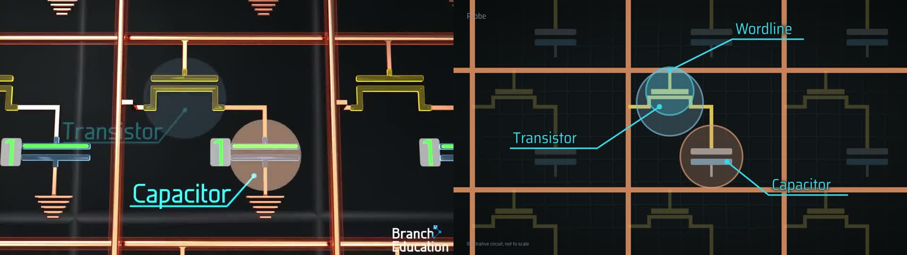
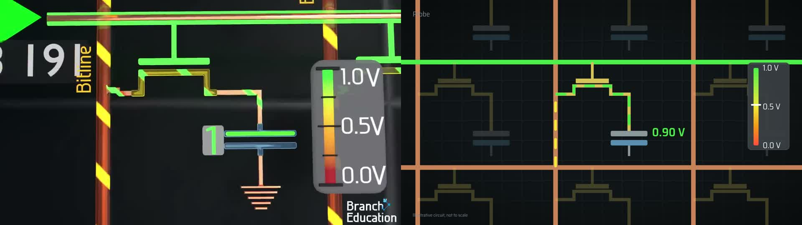

- **Already similar:** callout construction, lens, font, colour grammar, dark board, copper grid.
- **Clear gaps:**
  1. Wires are flat strokes; the reference wires have cylindrical shading (a dark edge with a light centre stripe) and a soft glow.
  2. Framing is too wide; the reference fills the frame with 2–3 cells.
  3. There are no "1"/"0" digit badges.
  4. Charged bitlines need moving yellow/black hazard stripes, not dashes.
  5. The gauge is smaller and lacks the bevel and tick bars.
  6. The section tag still collides with wires.
  7. Nothing has lighting or depth of field.


**Round 1 (real lesson renders, also done):** `comparison/round-1-lessons/` has 9 pairs and `scorecard.md`.
- **Verdict:** the vocabulary matches, but the overall look is not yet comparable.
- **Main gaps:** framing is too wide and text too small (often 20–40 px against Branch's 60–80 px), and wires and parts lack material/glow.
- **Weakest scene:** `u1-prefetch`.

Start your round 2 from the "Fixes for round 2" list in that scorecard.

- **R15 Narration pace (found while rendering):**
  - Kokoro speaks faster than the 2.6 words/s planning estimate. The 26 lesson scenes came out 44–60 s, not the planned 60–110 s.
  - `tts_lines` sends no speed parameter to Voicebox. Check whether the Voicebox/Kokoro API accepts a speed setting; if it does, expose it as a learner preference (`learn voice --speed 0.9`).
  - Also consider a per-scene `pause(after_line, seconds)` in the timing model, giving deliberate silent holds at segment boundaries (Spanjers et al. found such pauses help).

---

## E. Deliverables
1. Engine changes (R1–R11, R13), with tests passing.
2. Updated `references/hyperframes.md`, a new worked example, and a decision-log row.
3. `docs/visual-reference/branch-dram/comparison/round-*/`: pairs and scorecards for every round.
4. A short report (`docs/visual-reference/branch-dram/comparison/REPORT.md`) covering:
   - what changed;
   - final scores;
   - remaining gaps, stated honestly;
   - render-time impact;
   - whether a fresh model could author a passing scene from the docs.
5. A recommendation on R12 (Three.js) based on evidence, not on taste.
