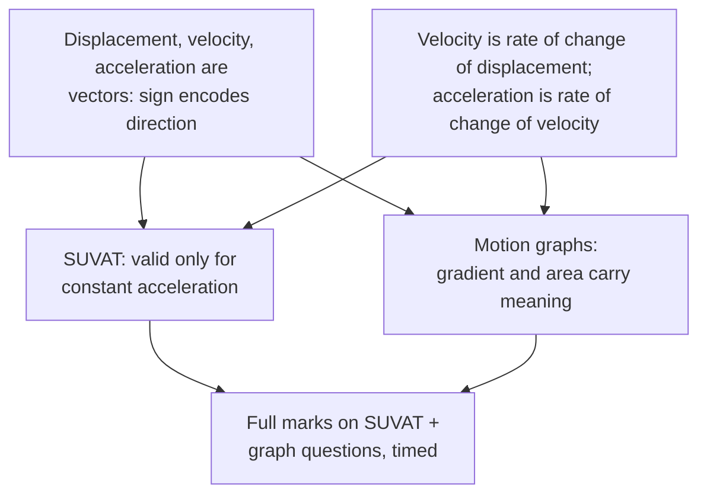

# Map: AS Physics — kinematics

## Node status
| Node | Status | Evidence |
| --- | --- | --- |
| A (vector signs) | shaky | missed reversal question twice, 2026-08-31 |
| B (definitions) | solid | quiz-checked 2026-08-31 |
| C (graphs) | solid (floor) | probe: correct on gradient + area |
| D (SUVAT) | shaky | applied $v = u + at$ to non-constant $a$ |
| G (goal) | untouched | — |

## Links
Brief: learning-brief.md · Anki deck: AS-Physics::Kinematics (drafts in queue)
