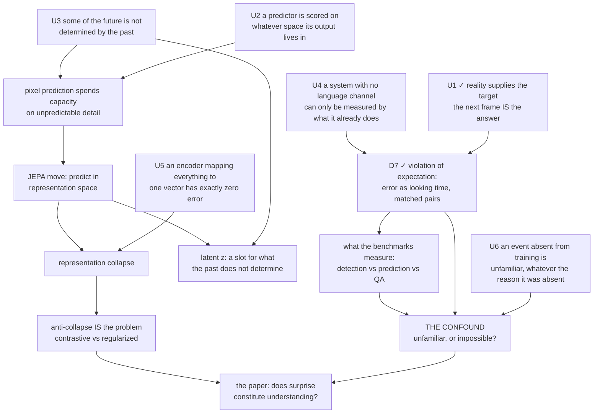

# Map: world models — does prediction-error surprise mean physical understanding?

Roots are unconditional truths; the sink is the paper's question. The map IS the teaching
order. Lecture moves in [sources/lecun-eth-2026.md](sources/lecun-eth-2026.md).

## Node status

| Node | Status | Evidence |
| --- | --- | --- |
| U1 reality supplies the target | solid | Derived unaided 2026-09-02 (Q3), then ratified |
| U2 scored in its output space | untouched | — |
| U3 future underdetermined | untouched | — |
| U4 no language channel ⟹ measure behaviour | solid | Taught 2026-09-02 with the infant looking-time origin |
| U5 constant encoder ⟹ zero error | untouched | — |
| U6 absent ⟹ unfamiliar | solid | Replaced a weaker draft root that needed a caveat (VFX and cartoons do contain impossible events) |
| D7 violation of expectation | solid | Taught 2026-09-02 (Q2 was a blank; answer given with the matched-pair protocol) |
| U6 → D10 the confound | solid | Taught 2026-09-02. Quiz-checked: missed the control question (chose a linear probe), corrected with the discrimination criterion |
| D2, D3, D4, D5, D6, D9, G | untouched | — |

## Demoted candidates

Two "foundations" failed the stress test and were pushed down:

- *"Prediction error is available at test time"* — derives from U1, so it is a step, not a root.
  Evidence it derives: the learner reconstructed it from U1 without being told.
- *"Training video contains no physically impossible events"* — needs a caveat (VFX, animation,
  edited cuts), so it is not unconditional. Replaced by U6, which is a definition and carries the
  same load.

## Links

Brief: [learning-brief.md](learning-brief.md) · mistakes: [mistake-log.md](mistake-log.md)
· sources: [source-register.md](source-register.md) · Anki tag: `world-models`
