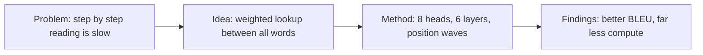

## 1. The paper at a glance
Access: full. The whole text was read; the figures and the attention-visualization images were not inspected (captions only), and the cited references were read only through the abstracts of two of them.

**Attention Is All You Need**, by Ashish Vaswani, Noam Shazeer, Niki Parmar, Jakob Uszkoreit, Llion Jones, Aidan N. Gomez, Lukasz Kaiser and Illia Polosukhin (Google Brain, Google Research and the University of Toronto). arXiv preprint, 12 June 2017 [S1].

- **Domain:** sequence modelling, mostly machine translation.
- **Problem:** models that read a sentence word by word are slow to train, because each step waits for the one before.
- **Contribution:** the Transformer, a network built only from attention, with no recurrence and no convolution.
- **Why it matters:** it reached the best translation scores of its time at a fraction of the training cost.

After this report you should be able to explain what attention does, why dropping recurrence speeds up training, how the Transformer is put together, and what its experiments do and do not show.

## 2. The problem and its motivation
Before this paper, the standard sequence models were recurrent networks. A recurrent network builds the hidden state at position t from the hidden state at position t minus 1, so it must go through a sentence in order. That order blocks parallel work inside one training example, and it matters most for long sequences [S1].

Attention already existed, but only on top of recurrent networks. It was introduced because a plain encoder-decoder squeezes the whole source sentence into one fixed-length vector, which the authors of that earlier work suspected was a bottleneck [S2][S3]. Convolutional models such as ByteNet and ConvS2S compute positions in parallel, but the number of steps needed to relate two distant words grows with their distance [S1].

![[Attachments/learn/attention-is-all-you-need/step-by-step.mp4]]

## 3. The central idea
Throw out the recurrence and let attention do all the work. Attention is a weighted lookup. One word makes a query. Every word offers a key, which says what it can be matched on, and a value, which is the content it hands over. The query is compared with every key, a better match gets a bigger weight, and the output is the values blended by those weights [S1].

You can think of it as asking a room of people a question and weighting each answer by how relevant that person's expertise is. That comparison is my own explanation, not the paper's.

![[Attachments/learn/attention-is-all-you-need/attention-lookup.mp4]]

The paper packs this into one formula: softmax of Q times K transposed, divided by the square root of d k, times V. The division keeps large scores from pushing the softmax into a flat region where it learns very little [S1].

![[Attachments/learn/attention-is-all-you-need/scaled-dot.mp4]]

It is useful because every pair of positions is connected in a constant number of sequential steps, where a recurrent layer needs a number that grows with the sentence length [S1].

## 4. How the proposed approach works
| component | what it does | receives | produces | why it exists |
| --- | --- | --- | --- | --- |
| scaled dot-product attention | blends values by query-key match | queries, keys, values | one blended vector per query | lets any position use any other [S1] |
| multi-head attention | runs 8 attention functions in parallel | the same inputs, projected 8 ways | joined outputs, mixed back to 512 dimensions | one head would average different kinds of information [S1] |
| encoder layer (6 of them) | self-attention, then a feed-forward network | the previous layer's vectors | richer vectors, same size | builds a representation of the input [S1] |
| decoder layer (6 of them) | masked self-attention, attention over the encoder, feed-forward | its own earlier outputs and the encoder output | the next-word prediction | writes the output one word at a time [S1] |
| position signals | sine and cosine waves added to the word vectors | word positions | vectors that carry order | nothing else tells the model the order [S1] |

![[Attachments/learn/attention-is-all-you-need/multi-head.mp4]]

![[Attachments/learn/attention-is-all-you-need/stack-and-order.mp4]]

## 5. What is actually new
- **Existed:** attention on top of recurrent encoder-decoders, which looks back at the source words for each output word [S2]. Recurrent encoder-decoders that pass one fixed-length vector [S3]. Convolutional models that work in parallel [S1].
- **Changed:** the authors removed recurrence and convolution entirely, scaled the dot products by one over the square root of d k, ran several heads in parallel, and added sine and cosine position signals [S1].
- **Why it matters:** the paper calls the Transformer the first transduction model built entirely on self-attention. That is the authors' own claim [S1].
- **Shown beyond the earlier work:** attention alone reaches state-of-the-art translation at a fraction of the training cost, and carries over to parsing [S1].

## 6. Experiments and results
The authors trained on WMT 2014 English-German (about 4.5 million sentence pairs) and English-French (36 million sentences), on one machine with 8 P100 GPUs. The base model trained for 12 hours, the big model for 3.5 days [S1]. They compared against ByteNet, GNMT with reinforcement learning, ConvS2S and a mixture-of-experts model, including ensembles [S1].

![[Attachments/learn/attention-is-all-you-need/evidence.mp4]]

- **English to German:** the big model scores 28.4 BLEU, more than 2 BLEU above the best earlier result including ensembles [S1].
- **Cost:** the base model scores 27.3 at about 3.3e18 training operations. The best ensemble in the comparison used 1.8e20, roughly fifty times more. The operation counts are the authors' estimate, from training time, GPU count and an assumed sustained speed per GPU [S1].
- **Model variations:** one head was 0.9 BLEU worse than the best head count, and too many heads also hurt. Shrinking the key size hurt. Learned position embeddings gave nearly the same result as sine waves [S1].
- **Parsing:** 91.3 F1 trained on WSJ only and 92.7 semi-supervised [S1].

What the evidence does not justify: the tests cover translation and parsing only, so they do not show the design wins on every task. BLEU is the only translation metric reported. The English-French score appears as 41.8 in the abstract and table but as 41.0 in the results text, and the paper does not explain the gap [S1].

## 7. Authors and research contributions
The paper states that all eight authors contributed equally and that the listing order is random [S1]. Individual roles below are the ones the paper's own footnote documents. This report did not look into the authors' wider careers.

- **Ashish Vaswani**: Google Brain. With Illia Polosukhin, designed and implemented the first Transformer models [S1].
- **Noam Shazeer**: Google Brain. Proposed scaled dot-product attention, multi-head attention and the parameter-free position representation [S1].
- **Niki Parmar**: Google Research. Designed, implemented, tuned and evaluated many model variants [S1].
- **Jakob Uszkoreit**: Google Research. Proposed replacing recurrent networks with self-attention and started the effort to test it [S1].
- **Llion Jones**: Google Research. Tried new model variants, wrote the first codebase, and worked on efficient inference and visualizations [S1].
- **Aidan N. Gomez**: University of Toronto, with the work done while at Google Brain. Implemented parts of tensor2tensor [S1].
- **Lukasz Kaiser**: Google Brain. Designed and implemented parts of tensor2tensor [S1].
- **Illia Polosukhin**: the work was done while at Google Research. With Ashish Vaswani, designed and implemented the first Transformer models [S1].

## 8. Practical applications
**Demonstrated in the paper:** machine translation between English and German, and English and French, and English constituency parsing [S1].

**Plausible but not shown:** the authors say they plan to apply the design to other kinds of input and output, such as images, audio and video, and to make generation less sequential [S1]. These are plans, not results.

**Engineering trade-offs.** A self-attention layer costs on the order of n squared times d, against n times d squared for a recurrent layer, so it is cheaper only while the sequence length n is below the vector size d. Its gain is the constant number of sequential steps [S1]. The authors suggest restricting attention to a neighbourhood for very long inputs, and list that as future work [S1].

**Compute:** the reported runs used 8 P100 GPUs, 12 hours for the base model and 3.5 days for the big one [S1].

**Where it may be the wrong tool (my reading):** inputs much longer than the vector size, where the n squared cost dominates.

## 9. Limitations and open questions
**Authors acknowledge:** averaging the attention-weighted positions reduces effective resolution, which multi-head attention is meant to counteract. Self-attention is costly for very long sequences, which they want to address with restricted attention. Generation is still one word at a time, and making it less sequential is a research goal [S1].

**Our analysis:** the English-French score is stated two ways in the same paper, 41.8 and 41.0. The evidence covers two task families and one translation metric. The compute comparison rests on the authors' own estimates. Figures and visualization images were not inspected here, so claims about what individual heads learn were not checked [S1]. Whether the gains hold on other tasks is open.

## 10. The mental model to retain
**Problem.** Reading a sequence one step at a time is slow to train and blocks parallel hardware.

**Core insight.** Let every position look at every other position through a weighted lookup, so nothing has to wait.

**How it works.** Queries are matched against keys, the weights blend the values, eight heads do this side by side, six-layer encoder and decoder stacks repeat it, and position signals restore word order [S1].

**Main contribution.** The first translation model built only on attention, as the authors state [S1].

**Evidence.** 28.4 BLEU on English-German, over 2 BLEU above the best earlier result, at about fifty times less training compute for the base model, plus strong parsing results [S1].

**Where it helps.** Translation and parsing, demonstrated; other input types, planned.

**Limits.** Only two task families tested, quadratic cost in sequence length, one inconsistent headline number.

**Go deeper.** The earlier attention paper [S2], then the encoder-decoder it builds on [S3], then the paper's own attention-visualization figures.

