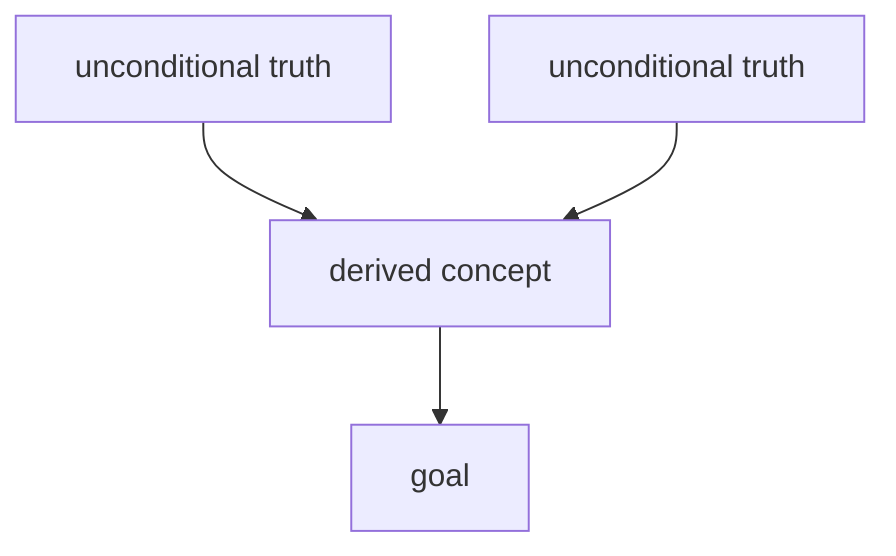

# Map: <subject>

Lives in vault `Maps/`. One per subject. The mermaid DAG is the map; keep it small
(≤ ~15 nodes) — a map, not the territory. Roots = unconditional truths; sink = goal.

## Node status
| Node | Status | Evidence |
| --- | --- | --- |
| A | solid / shaky / untouched | quiz-checked YYYY-MM-DD / missed twice |

## Links
Brief: <repo path> · Concepts: [[...]] · Anki deck: <deck name>
